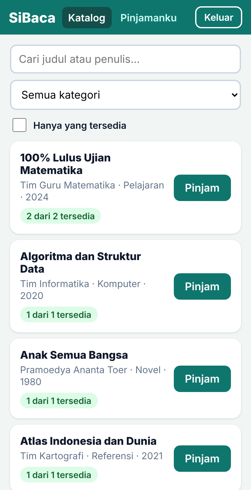
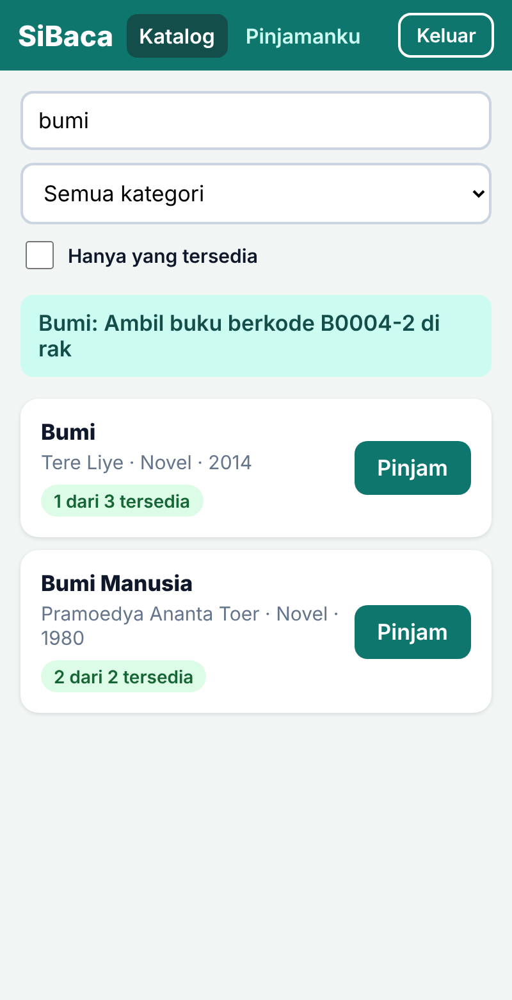
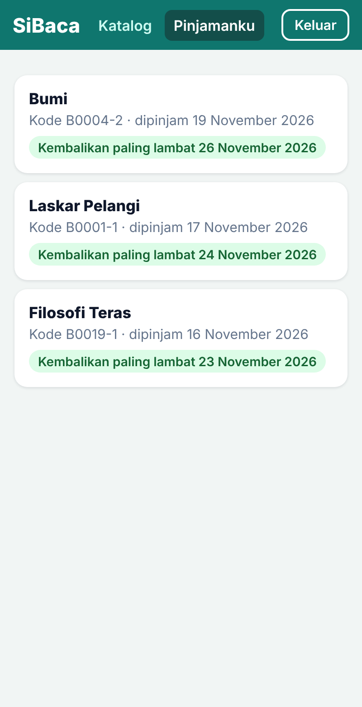
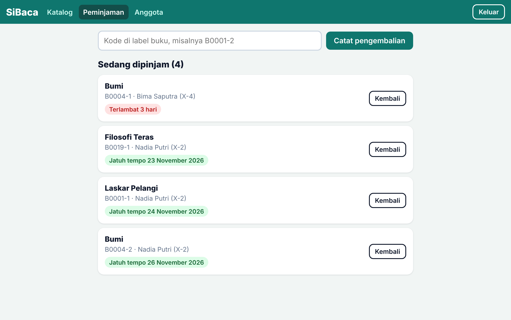
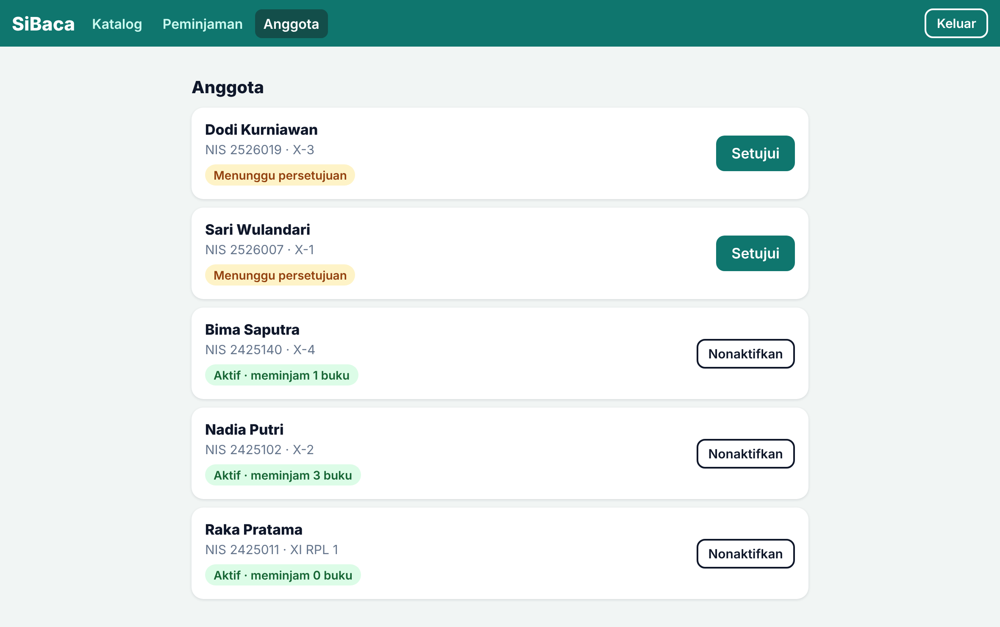

# SiBaca

Aplikasi perpustakaan sekolah yang dibuka dari HP dan **berjalan tanpa internet**. Dibangun dari nol dengan **React (Vite), Express, dan MySQL**.

Siswa mencari buku dan menekan Pinjam dari HP-nya sendiri. Petugas perpustakaan mencatat pengembalian, menyetujui anggota baru, dan menambah buku dari laptopnya. Satu laptop di meja petugas menjadi servernya, dan sebuah router WiFi kecil tanpa sambungan internet menghubungkannya dengan HP para siswa.

| Katalog di HP | Pinjam | Pinjamanku |
| --- | --- | --- |
|  |  |  |

| Peminjaman (petugas) | Anggota (petugas) |
| --- | --- |
|  |  |

Kode ini adalah hasil akhir video tutorial **"Membangun Aplikasi Perpustakaan dari Nol"** di kanal YouTube [@iTeachSWE](https://www.youtube.com/@iTeachSWE). Setiap bab di video punya tag sendiri di repo ini, jadi kamu bisa melihat kode persis seperti di akhir bab mana pun (lihat [Kode per bab](#kode-per-bab)).

## Daftar isi

- [Yang bisa dilakukan aplikasinya](#yang-bisa-dilakukan-aplikasinya)
- [Memasang alat](#memasang-alat)
- [Menjalankan proyek ini](#menjalankan-proyek-ini)
- [Akun contoh](#akun-contoh)
- [Menjalankan tanpa internet dan membukanya dari HP](#menjalankan-tanpa-internet-dan-membukanya-dari-hp)
- [Uji otomatis](#uji-otomatis)
- [Cadangan data](#cadangan-data)
- [Kode per bab](#kode-per-bab)
- [Daftar periksa untuk kode buatan AI](#daftar-periksa-untuk-kode-buatan-ai)
- [Susunan folder](#susunan-folder)

## Yang bisa dilakukan aplikasinya

**Anggota (siswa)**

- Mendaftar sendiri dari HP. Akun baru aktif setelah disetujui petugas.
- Mencari buku lewat judul atau penulis, memilih kategori, dan menyaring hanya buku yang tersedia.
- Meminjam buku. Aplikasi menyebut kode eksemplar yang harus diambil di rak, misalnya `B0004-2`.
- Melihat pinjamannya sendiri beserta tanggal kembalinya.

**Petugas**

- Melihat semua peminjaman yang sedang berjalan, termasuk yang terlambat.
- Mencatat pengembalian dengan mengetik kode di label buku.
- Menyetujui atau menonaktifkan anggota.
- Menambah judul buku beserta jumlah eksemplarnya.

**Aturan peminjaman**

- Paling banyak 3 buku per siswa, masing-masing selama 7 hari, tanpa denda.
- Siswa yang masih memegang buku terlambat tidak bisa meminjam lagi sampai buku itu kembali.
- Semua aturan diperiksa di server, di dalam satu transaksi database, bukan hanya di tampilan.

## Memasang alat

Kamu memerlukan empat alat. Semuanya gratis.

| Alat | Kegunaan | Versi yang dipakai di video |
| --- | --- | --- |
| Node.js (LTS) | menjalankan JavaScript di luar browser | 22 |
| MySQL Community Server | database | 8 |
| Git | menyimpan riwayat kode | 2.43 atau lebih baru |
| VS Code | tempat menulis kode | terbaru |

### Windows

1. **Node.js**: buka <https://nodejs.org>, unduh versi LTS, jalankan penginstalnya, dan biarkan semua pilihan apa adanya.
2. **MySQL**: buka <https://dev.mysql.com/downloads/>, pilih *MySQL Installer for Windows*. Pilih jenis pemasangan *Server only*. Di halaman *Accounts and Roles*, buat kata sandi untuk pengguna `root` dan catat. Halaman lain biarkan seperti bawaannya.
3. **Git**: unduh dari <https://git-scm.com>, pasang dengan pilihan bawaan. Git Bash ikut terpasang.
4. **VS Code**: unduh dari <https://code.visualstudio.com>.

Setelah semuanya terpasang, buka VS Code, pilih menu **Terminal → New Terminal**, klik panah kecil di samping tanda `+`, lalu pilih **Git Bash**. Dengan begitu, perintah di terminalmu sama persis dengan yang ada di video.

Periksa keempatnya:

```bash
node --version
npm --version
mysql --version
git --version
```

Kalau keempatnya menjawab dengan nomor versi, semua alat sudah siap.

#### Kalau ada yang menjawab `command not found`

1. Tutup VS Code, buka lagi, lalu coba sekali lagi. Terminal yang sudah terbuka sebelum pemasangan belum mengenal program yang baru dipasang.
2. Kalau `mysql` masih tidak dikenali, Windows belum tahu letak programnya. Tambahkan foldernya ke PATH:
   1. Tekan tombol Windows, ketik **environment variables**, lalu buka **Edit the system environment variables**.
   2. Klik **Environment Variables…**, pilih baris **Path** di bagian *User variables*, lalu klik **Edit**.
   3. Klik **New**, lalu isi dengan `C:\Program Files\MySQL\MySQL Server 8.0\bin` (sesuaikan angka versinya dengan folder yang ada di komputermu).
   4. Klik OK di semua jendela, tutup VS Code, lalu buka lagi.

### macOS

Pasang [Homebrew](https://brew.sh) lebih dulu, lalu:

```bash
brew install node mysql git
brew install --cask visual-studio-code
brew services start mysql
mysql_secure_installation   # membuat kata sandi root
```

### Linux (Ubuntu atau Debian)

```bash
sudo apt update
sudo apt install -y mysql-server git curl
curl -fsSL https://deb.nodesource.com/setup_22.x | sudo -E bash -
sudo apt install -y nodejs
sudo snap install code --classic
```

Di Ubuntu, pengguna `root` MySQL masuk tanpa kata sandi lewat `sudo mysql`. Jadi, pada langkah membuat database di bawah, pakai `sudo mysql` sebagai pengganti `mysql -u root -p`.

## Menjalankan proyek ini

### 1. Ambil kodenya

```bash
git clone https://github.com/listyantidewi1/SiBaca.git sibaca
cd sibaca
npm install
cd web
npm install
cd ..
```

Lalu buka folder `sibaca` di VS Code lewat menu **File → Open Folder**.

### 2. Buat database dan penggunanya

Aplikasi ini tidak memakai `root`. Kita membuat satu pengguna yang hanya punya hak atas satu database, supaya kalau suatu saat aplikasinya dibobol, penyerang hanya mendapat database itu.

```bash
mysql -u root -p
```

```sql
CREATE DATABASE sibaca;
CREATE USER 'sibaca'@'localhost' IDENTIFIED BY 'gantiSandiIni!';
GRANT ALL PRIVILEGES ON sibaca.* TO 'sibaca'@'localhost';
exit
```

Ganti `gantiSandiIni!` dengan kata sandimu sendiri.

### 3. Isi berkas `.env`

Berkas `.env` berisi pengaturan yang berbeda di setiap komputer, termasuk kata sandi. Berkas itu tidak ikut ke GitHub. Yang ikut adalah contohnya.

```bash
cp .env.example .env
```

Buka `.env`, lalu isi dua baris yang masih kosong:

```ini
PORT=3000
DB_HOST=127.0.0.1
DB_USER=sibaca
DB_PASSWORD=gantiSandiIni!
DB_NAME=sibaca
SESSION_SECRET=
```

`SESSION_SECRET` adalah kunci untuk menandatangani cookie login. Isinya harus panjang dan acak. Buat dengan perintah ini, lalu tempelkan hasilnya:

```bash
node -e "console.log(require('crypto').randomBytes(32).toString('hex'))"
```

### 4. Buat tabel dan isi data contoh

```bash
mysql -u sibaca -p sibaca < database/schema.sql
npm run contoh
```

Perintah kedua mengisi 525 judul buku, satu akun petugas, dan beberapa akun siswa.

> `npm run contoh` mengosongkan semua tabel lebih dulu. Jangan jalankan di database yang sudah berisi data sungguhan.

### 5. Jalankan

Selama mengembangkan, ada dua program yang berjalan di dua terminal:

```bash
# Terminal 1: server Express, di folder sibaca
npm run dev
```

```bash
# Terminal 2: tampilan React, di folder sibaca/web
cd web
npm run dev
```

Buka <http://localhost:5173> di browser.

## Akun contoh

Kata sandi semua akun contoh: `rahasia123`

| Nama | NIS (untuk login) | Peran | Keadaan |
| --- | --- | --- | --- |
| Bu Ratih | `petugas` | petugas | aktif |
| Raka Pratama | `2425011` | anggota | aktif, belum meminjam |
| Nadia Putri | `2425102` | anggota | aktif, sedang meminjam dua buku |
| Bima Saputra | `2425140` | anggota | aktif, pinjamannya terlambat |
| Sari Wulandari | `2526007` | anggota | menunggu persetujuan |
| Dodi Kurniawan | `2526019` | anggota | menunggu persetujuan |

Sebelum dipakai sungguhan, ganti kata sandi akun petugas dan hapus akun contoh lainnya.

## Menjalankan tanpa internet dan membukanya dari HP

### 1. Kemas tampilannya

```bash
cd web
npm run build
cd ..
npm start
```

`npm run build` mengemas seluruh kode React, gaya tampilan, dan hurufnya menjadi berkas biasa di folder `web/dist`. Setelah itu, `npm start` menjalankan satu program saja: Express melayani tampilan sekaligus datanya di port 3000. Tidak ada satu berkas pun yang diambil dari internet.

Buka <http://localhost:3000>. Perhatikan, portnya 3000, bukan 5173.

### 2. Cari alamat laptop

Laptop dan HP harus tersambung ke WiFi yang sama.

| Sistem | Perintah | Yang dicari |
| --- | --- | --- |
| Windows | `ipconfig` | baris *IPv4 Address* |
| macOS | `ipconfig getifaddr en0` | angka yang muncul |
| Linux | `hostname -I` | angka pertama |

Misalnya alamatnya `192.168.1.10`. Di browser HP, buka `http://192.168.1.10:3000`.

### 3. Kalau halamannya tidak mau terbuka di HP

Hampir selalu penyebabnya firewall. Saat server pertama kali dijalankan, Windows menampilkan jendela *Windows Security Alert*. Centang **Private networks**, lalu tekan **Allow access**.

Kalau jendela itu telanjur ditutup:

1. Tekan tombol Windows, ketik **Allow an app through Windows Firewall**, lalu buka.
2. Klik **Change settings**.
3. Cari **Node.js JavaScript Runtime** di daftar, lalu centang kolom **Private**. Kalau ada beberapa baris bernama sama, centang semuanya.
4. Kalau tidak ada di daftar, klik **Allow another app… → Browse**, lalu pilih `C:\Program Files\nodejs\node.exe`.
5. Klik OK, lalu coba lagi dari HP.

Periksa juga tiga hal ini:

- HP tersambung ke WiFi yang sama dengan laptop, bukan memakai data seluler.
- Jaringan WiFi itu bertipe *Private* di Windows (Settings → Network & Internet → WiFi → nama jaringan → *Private network*).
- Alamatnya diketik lengkap dengan `http://` di depan dan `:3000` di belakang.

### 4. Supaya alamat laptop tidak berubah

Alamat laptop bisa berubah setiap kali router dinyalakan ulang. Supaya tetap, buka halaman pengaturan router (biasanya `192.168.1.1` atau `192.168.0.1`), cari menu **DHCP → Address Reservation**, lalu kunci alamat untuk laptop server.

### 5. Ikon "Mulai SiBaca" untuk petugas

Supaya petugas tidak perlu membuka terminal, buat berkas bernama `Mulai SiBaca.bat` di desktop laptop perpustakaan. Sesuaikan `C:\sibaca` dengan letak folder proyekmu.

```bat
@echo off
title SiBaca - jangan tutup jendela ini
cd /d C:\sibaca
npm start
pause
```

Panduan satu halaman untuk petugas ada di [PANDUAN.md](PANDUAN.md). Silakan sesuaikan dengan sekolahmu.

## Uji otomatis

```bash
npm run contoh
npm test
```

Empat test di folder `uji` memeriksa jebakan yang pernah kita tutup: pendaftaran tidak bisa memilih peran sendiri, halaman petugas menolak anggota, pinjaman keempat ditolak server, dan tanda `%` di kotak cari diperlakukan sebagai huruf biasa. Jalankan setiap kali kamu, atau AI, mengubah kode.

Test memakai akun contoh, jadi jalankan `npm run contoh` lebih dulu, dan jangan jalankan di database yang berisi data sungguhan.

## Cadangan data

### Membuat dan memulihkan cadangan

```bash
mkdir backup
mysqldump --no-tablespaces -u sibaca -p sibaca > backup/sibaca.sql
```

Pilihan `--no-tablespaces` diperlukan karena pengguna `sibaca` hanya punya hak atas satu database.

Untuk memulihkannya, di laptop yang sama atau di laptop lain:

```bash
mysql -u sibaca -p sibaca < backup/sibaca.sql
```

### Ikon "Cadangkan SiBaca" untuk petugas

Cadangan yang disimpan di laptop yang sama tidak menolong kalau laptopnya rusak. Dua berkas kecil ini membuat petugas cukup mencolokkan flashdisk dan mengeklik satu ikon.

**1.** Buat berkas `C:\sibaca-rahasia\cadangan.cnf`. Berkas ini berisi kata sandi database, jadi letakkan di luar folder proyek.

```ini
[client]
user=sibaca
password=gantiSandiIni!
```

**2.** Buat berkas `Cadangkan SiBaca.bat` di desktop. Sesuaikan huruf flashdisk (`E:`) dengan laptopmu.

```bat
@echo off
set TUJUAN=E:\
if not exist %TUJUAN% (
  echo Flashdisk CADANGAN belum dicolokkan.
  pause
  exit /b
)
for /f %%i in ('powershell -NoProfile -Command "Get-Date -Format yyyy-MM-dd"') do set TGL=%%i
mysqldump --defaults-extra-file=C:\sibaca-rahasia\cadangan.cnf --no-tablespaces sibaca > "%TUJUAN%sibaca-%TGL%.sql"
if errorlevel 1 (
  echo Cadangan GAGAL. Hubungi guru pembina.
  pause
  exit /b
)
echo Cadangan tersimpan: %TUJUAN%sibaca-%TGL%.sql
timeout /t 5
```

Setiap sore, petugas mencolokkan flashdisk, mengeklik ikon itu dua kali, dan cadangan bertanggal hari itu tersimpan di flashdisk.

**Sebulan sekali, coba pulihkan cadangan itu di komputer lain.** Cadangan yang tidak pernah dicoba dipulihkan belum bisa disebut cadangan.

## Kode per bab

Setiap bab di video diakhiri satu commit dan satu tag. Untuk melihat kode persis seperti di akhir sebuah bab:

```bash
git checkout bab-05      # kode di akhir Bab 5
git checkout main        # kembali ke hasil akhir
```

| Tag | Bab | Yang ditambahkan |
| --- | --- | --- |
| `bab-01` | Persiapan | proyek Express dan Vite, `.env`, `.gitignore` |
| `bab-02` | Kebutuhan | belum ada kode baru, isinya sama dengan `bab-01` |
| `bab-03` | Merancang database | `database/schema.sql` |
| `bab-04` | API dengan Express | `server/db.js`, `server/buku.js`, data contoh |
| `bab-05` | Daftar dan login | `server/auth.js`, cookie bertanda tangan |
| `bab-06` | React pertama | halaman Masuk, Daftar, dan Katalog |
| `bab-07` | Pencarian | kata kunci, kategori, hanya yang tersedia |
| `bab-08` | Pinjam dan kembali | `server/pinjam.js`, halaman Pinjamanku |
| `bab-09` | Halaman petugas | `server/petugas.js`, tiga halaman petugas |
| `bab-10` | Berjalan tanpa internet | Express menyajikan `web/dist` |
| `bab-11` | Uji, backup, dan panduan | `uji/`, `PANDUAN.md` |

Bab 2 berisi obrolan kebutuhan dengan petugas perpustakaan, jadi belum ada kode baru. Tag `bab-02` menunjuk ke kode yang sama dengan `bab-01`.

## Daftar periksa untuk kode buatan AI

Di setiap bab video ada segmen *Cek kerjaan AI*: potongan kode yang lazim muncul kalau kita meminta AI dengan perintah singkat. Semuanya berjalan dan tidak satu pun menampilkan error. Pakai daftar ini setiap kali kamu menerima kode dari AI.

| # | Jebakan | Pertanyaan untuk memeriksanya | Bab |
| --- | --- | --- | --- |
| 1 | `root` dan kata sandi ditulis di dalam kode | Apakah aplikasi memakai pengguna database khusus, dan apakah rahasianya ada di `.env`? | 1 |
| 2 | Tabel dibuat tanpa bertanya kepada pemakai | Apakah rancangan datanya sudah dicocokkan dengan cara kerja orang yang akan memakainya? | 2 |
| 3 | Kolom `stok` dikurangi satu setiap peminjaman | Apakah setiap barang yang perlu dilacak punya barisnya sendiri? | 3 |
| 4 | SQL injection: masukan disambung ke teks query | Apakah semua masukan dikirim sebagai parameter (`?`)? | 4 |
| 5 | Peran dan status akun diambil dari kiriman form | Apakah server sendiri yang menentukan peran dan status? | 5 |
| 6 | Alamat `localhost` di kode tampilan, `key` berupa nomor urut, dan kegagalan tidak ditangani | Apakah alamat API-nya relatif, apakah `key` memakai id dari data, dan apa yang tampil kalau server tidak menjawab? | 6 |
| 7 | Query tanpa `LIMIT`, dan tanda `%` lolos ke `LIKE` | Berapa baris yang dikirim kalau datanya 500? Apa yang terjadi kalau pemakai mengetik `%`? | 7 |
| 8 | Batas pinjam hanya diperiksa di browser | Apakah aturannya diperiksa di server, di dalam transaksi? | 8 |
| 9 | Menghapus anggota beserta riwayat peminjamannya | Apakah data yang masih dirujuk dinonaktifkan, bukan dihapus? | 9 |
| 10 | Huruf dan gaya tampilan diambil dari internet | Apakah aplikasinya tetap utuh kalau internet dicabut? | 10 |
| 11 | Cadangan disimpan di laptop yang sama, dengan nama berkas yang selalu sama | Kalau laptop ini rusak hari ini, data mana yang selamat? Kalau data rusak kemarin, apakah cadangan kemarin lusa masih ada? | 11 |

Polanya selalu sama: AI mengerjakan persis apa yang diminta, dan tidak memikirkan hal yang lupa kita ceritakan. Kesalahannya baru terlihat oleh orang yang paham kebutuhannya dan paham kodenya.

## Susunan folder

```text
sibaca/
├── server/            server Express
│   ├── app.js         titik masuk, memasang semua router
│   ├── db.js          sambungan ke MySQL
│   ├── auth.js        daftar, masuk, keluar, dan dua penjaga
│   ├── buku.js        katalog dan pencarian
│   ├── pinjam.js      meminjam (transaksi) dan pinjaman sendiri
│   └── petugas.js     pengembalian dan pengelolaan anggota
├── web/               tampilan React (Vite)
│   └── src/
│       ├── App.jsx    menu dan rute
│       ├── api.js     satu fungsi untuk semua permintaan ke server
│       ├── gaya.css   seluruh gaya tampilan
│       └── halaman/   Masuk, Daftar, Katalog, Pinjaman, Petugas, Anggota, TambahBuku
├── database/
│   ├── schema.sql     empat tabel
│   ├── daftar-buku.js koleksi contoh
│   └── isi-contoh.js  pengisi data contoh (npm run contoh)
├── uji/               test otomatis (npm test)
├── backup/            tempat cadangan .sql (tidak ikut ke Git)
├── PANDUAN.md         panduan satu halaman untuk petugas
└── .env.example       contoh pengaturan
```

## Catatan untuk pemakai PowerShell

Video memakai Git Bash. Kalau kamu memakai PowerShell, tulis `curl.exe`, bukan `curl`, karena di PowerShell `curl` adalah nama lain dari perintah yang berbeda. Perintah `cp` dan tanda `<` untuk mengalirkan berkas ke `mysql` juga berperilaku berbeda di PowerShell, jadi untuk mengikuti video, pakailah Git Bash.

## Lisensi

Kode ini boleh dipakai, diubah, dan dibagikan untuk belajar maupun untuk perpustakaan sekolahmu.
